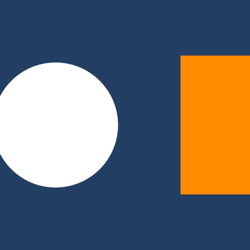
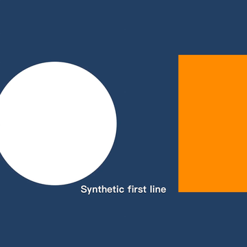
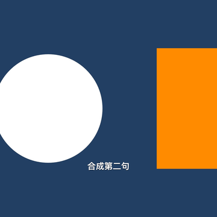

# 编辑预览增量验证

代码 `f569647d4a8b501f2f341da03ead0f211c65229e`，原分支 `codex/my-cover-studio-v1`。
[Actions 40044401370](https://github.com/lunnn325/Cover-Studio/actions/runs/40044401370)，job `120722672585`，整体成功。

23 项核心 XCTest、arm64/x86_64 无签名编译通过。Xcode 26.6 / iOS Simulator 26.2。此次选用 `preview_check_only`，只验证新预览路径；复用[上一轮五种导出和工程恢复证据](../2026-10-24/README.md)。

原样保存的 MediaSmokeReport.json：`passed=true`，`errors=[]`。

- 两秒合成声音/几何照片，在歌曲 0.25–1.75 秒裁剪为 1.5 秒，预览 composition 为 1080×1080，包含音频与视频轨。
- 无字幕与带字幕预览均使用真实 AVPlayerItem 和视频 composition。帧提取观察到方形裁切、白圆从右到左/橙块从左到右的镜像，以及不同时间的中英文字幕。
- 字幕预览帧相对无字幕帧有 669/491 个明显变化像素，已人工查看三个缩小帧。
- 原导出 queue.json 字节与 service jobs 保持不变，所有源资产 SHA-256 不变。
- 关闭后两份预览各自的 cache/preview-UUID 目录都不存在；没有删除源资产或成品。

本模式报告中 `outputs=[]`、`archiveRestored=false` 表示未重跑成品/工程包检查，不是恢复失败；请结合 scope 与 preview 字段读取。

artifact `12540986886`，ZIP SHA-256：
`5ea831b9b8d65dd086e8b6a08a336d624d7520b84cf873672a3f7c70b261b2c4`。

这是软件 composition 与输出帧检查，没有通过点击 UI 实际操作播放器，也没有验证真人音质、麦克风/摄像头、AirPods、声学同步、长片段性能、Files 提供者或实机迁移。整体 P0 gate 仍保持必要实机项未验证。
