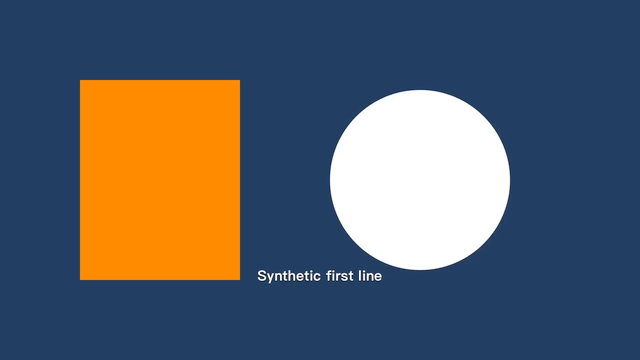
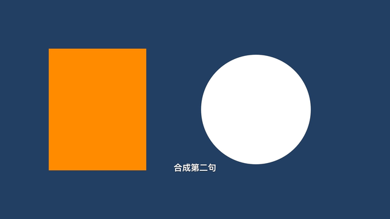

# 2026-10-24 集中验证证据

验证代码：`b3bfcdf343c7311d26611faefab7453588bbb18a`，分支 `codex/my-cover-studio-v1`。
[Actions 40042964676](https://github.com/lunnn325/Cover-Studio/actions/runs/40042964676) 整体成功，job `120718051915`。

环境：Xcode 26.6，iOS Simulator 26.2（23C54）。23 项 XCTest 核心测试、arm64/x86_64 无签名应用编译成功。Swift Testing 另打印的 0 tests 是未使用的第二套测试框架；23 个 XCTest 已逐一执行。

`MediaSmokeReport.json` 是从该次 CI artifact 原样复制的报告。路径属于隔离模拟器临时合成素材，不是可在本机打开的成品地址。报告 `passed=true`、`errors=[]`、`archiveRestored=true`：

- 两个 MP4 和三份 WAV 均非空、两秒，轨道类型符合选择，WAV 有非零 PCM。
- 干声为 440 Hz。220 Hz 伴奏升三半音后，Goertzel 主频 261.5 Hz（预期 261.626 Hz），仍为两秒。
- 下载合成 WAV 后，以独立 NumPy Hann-window FFT（262144 点，分析 0.4–1.6 秒）测得 261.658 Hz。之前错误版本为 240.417 Hz；显式修正 effect 输入/输出源采样率后通过，未放宽测试阈值。
- 中英文歌词在 0.25/1.25 秒输出帧中分别出现，与无字幕背景相比有 692/529 个明显变化像素。以下是实际导出视频提取的缩小帧，不是界面或设计稿。
- 工程包恢复至另一隔离目录后，Take、歌词、编辑图和各源文件字节/哈希一致。

原 artifact `12539683739`，ZIP SHA-256：
`8fa8e9658f0d09f8e7b97f75374225d446a7190b780642c7c993a322e7a0b120`。
CI artifact 保留 7 天；此目录保留小报告和帧，未将合成音视频大文件加入仓库。

这只验证两秒合成素材的离线软件路径。没有麦克风/相机采集、AirPods、真人听感、声学同步、长时间录制、危险空间、来电/后台、真实 Files 提供者或跨设备迁移结果，也没有合法签名 IPA。完整 gate 状态仍以 DELIVERY_STATUS.md 为准。
